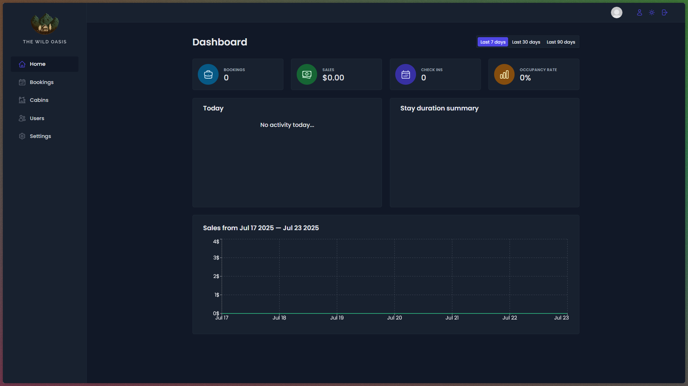

# The Wild Oasis - Hotel Management App

**Live Demo:** [https://the-wild-oasis-your-name.vercel.app/](https://serenity-stays.vercel.app/)



## 📝 Project Overview

The Wild Oasis is a full-featured internal management application for a hotel. It allows hotel employees to manage cabins, bookings, and guest data. This project was built to master advanced React concepts and modern front-end development practices.

## ✨ Key Features

* **User Authentication:** Secure login for hotel employees.
* **Data Visualization:** Interactive dashboard with charts showing key metrics (e.g., sales, occupancy rates).
* **Booking Management:** Full CRUD (Create, Read, Update, Delete) functionality for bookings.
* **Cabin Management:** Employees can view, create, edit, and delete hotel cabins.
* **Client-Side Filtering & Sorting:** Dynamic filtering and sorting of data tables for a seamless user experience.

## 🛠️ Tech Stack / Built With

* **React 18**
* **React Router** for client-side routing
* **Styled Components** for component-level styling and theming
* **React Query** for server state management (fetching, caching, synchronizing data)
* **React Hook Form** for building performant and flexible forms
* **Recharts** for creating data visualization charts
* **Supabase** for the backend database and authentication

## 🚀 Getting Started

### Prerequisites

You will need `npm` or `yarn` installed on your machine.

### Installation & Setup

1.  Clone the repository:
    ```sh
    git clone [https://github.com/your-username/the-wild-oasis.git](https://github.com/your-username/the-wild-oasis.git)
    ```
2.  Navigate to the project directory:
    ```sh
    cd the-wild-oasis
    ```
3.  Install dependencies:
    ```sh
    npm install
    ```
4.  Create a `.env.local` file in the root directory and add your Supabase credentials:
    ```
    VITE_SUPABASE_KEY=your_key_here
    VITE_SUPABASE_URL=your_url_here
    ```
5.  Run the development server:
    ```sh
    npm run dev
    ```

## 🧠 Architectural Decisions & Lessons Learned

This is the most important section for your interview prep.

* **State Management:** I chose **React Query** for managing server state because of its powerful caching capabilities, which significantly reduced loading times on the dashboard. It simplified data fetching logic compared to using `useEffect` and `useState`, preventing common pitfalls like race conditions. For global UI state (like the dark mode toggle), I used **Context API** as it was lightweight and sufficient for the task, avoiding the boilerplate of a larger library like Redux.

* **Styling Strategy:** **Styled Components** were used to encapsulate styles at the component level. This made components truly reusable and prevented CSS class name collisions. Theming support was also a key factor, allowing for easy implementation of a dark/light mode.
